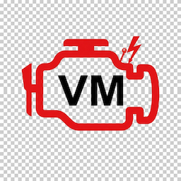
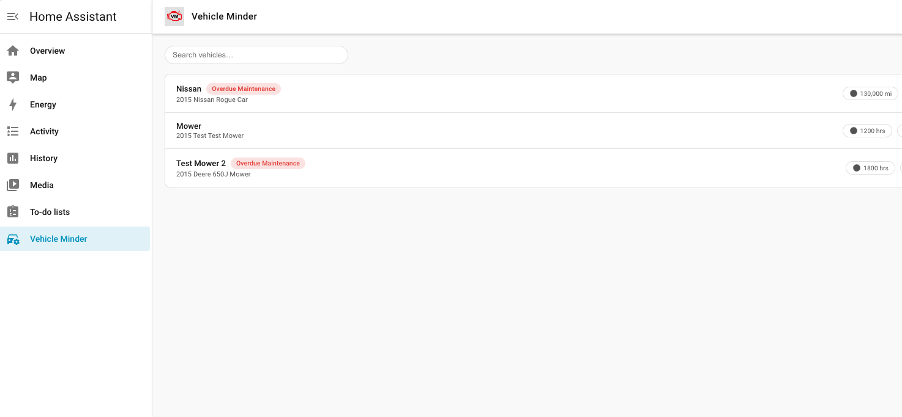

  # Vehicle Minder
[![Release][release-shield]][releases]
[![GitHub Release Date][release-date-shield]][releases]
[![GitHub Activity][commits-shield]][commits]
[![hacs][hacs-shield]][hacs]
[![License][license-shield]](LICENSE)

## Overview
Vehicle Minder is an integration for Home Assistant that lets you track your vehicle fleet and track maintenance on your vehicles.  It can be used to track cars, trucks, motorcycles and other road vehicles.  You can also use it to track ATVs, tractors, mowers and other offroad equipment.  

## Features

#### Fleet View
Your fleet is all of the vehicles in your fleet.  Vehicles can be cars, trucks, motorhomes, campers. They can also be off-road vehicles - mowers, heavy equipment, boats, etc.  Vehicle Minder can track service intervals at distance (miles) or time (hours)
or for some maintenance items that are measured at service intervals of months.

#### [Vehicle Detail View](docs/vehicle.md)
Each vehicle in your fleet is represented as a separate row in the Fleet Dashboard. Each vehicle maintains its own listing of [Maintenance Items](docs/maintenance_items.md) and [Service History](docs/service_records.md). Overdue maintenance items are flagged as overdue.  

#### [Service History](docs/service_records.md)
tory and maintenance performed on your vehicles.  Service records are tied to a maintenance item.  See [Service Records](docs/service_records.md) for more details.  

#### [Maintenance Items](docs/maintenance_items.md)
Maintenance Items track what needs to be maintained on each vehicle.  A vehicle carries it's own list of maintenance items. Maintenance items can be things like oil changes, filter changes, tire rotations, tire replacements or other service items.  See [Maintenance Items](docs/maintenance_items.md) for more details.  

### Installation
Vehicle Minder is a custom integration that gets installed in Home Assistant using [HACS]https://hacs.xyz/

1.  In HACS,add  https://github.com/crokett/vehicle_minder as a custom repository with the Integration category.
2.  Install Vehicle Minder and then restart Home Assistant
3.  Go to Settings → Devices & Services → Add Integration → Home Keeper and add the integration
4.  A Vehicle Minder panel appears in the sidebar. Your fleet is stored as a single JSON document on local storage 
5.  Read [Fleet Management](docs/fleet.md) for instructions on how to get started and add your first vehicle

[releases]: https://github.com/crokett/vehicle_minder/releases
[release-shield]: https://img.shields.io/github/v/release/crokett/vehicle_minder.svg?style=for-the-badge
[release-date-shield]: https://img.shields.io/github/release-date/crokett/vehicle_minder?style=for-the-badge
[commits-shield]: https://img.shields.io/github/last-commit/crokett/vehicle_minder?style=for-the-badge
[commits]: https://github.com/crokett/vehicle_minder/commits/main
[hacs-shield]: https://img.shields.io/badge/HACS-Custom-41BDF5.svg?style=for-the-badge
[hacs]: https://github.com/hacs/integration
[license-shield]: https://img.shields.io/github/license/crokett/vehicle_minder.svg?style=for-the-badgestyle=for-the-badge
