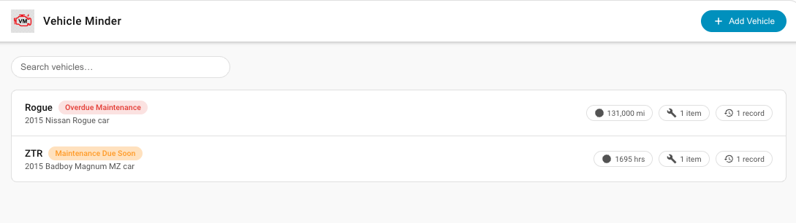

# Fleet Management

Your fleet is the collection of vehicles that you manage.  This can be onroad: cars, trucks, motorcycles, RVs or off-road: mowers, tractors and other equipment.  You could even manage non-vehicles such as any tool with an engine that required regular maintenance.  Anything that measures usage in distance or time (hours) can be managed.  

### Fleet View
This is the Fleet View.  This fleet has a car and a mower in it. Note that the car usage is measured in current mileage.  The mower usage is measured in hours.  Both vehicles have1  maintenance item and one service record.  The car has maintenance that is overdue. This means that the difference between the current mileage on the vehicle is and the milage in the last the service record for that maintenance item is different than the service interval specified in the maintenance item.  

Look at [Maintenance Items](docs/maintenance_items.md) on that vehicle to find the one that is overdue.  You would also see this if no service records are found for a vehicle.  

The mower has maintenance due soon.  This means there is a maintenance item that is not overdue yet but the usage hours on the mower is close to the interval specified on the maintenance item, and is within the threshold warning configured on that maintenance item.   See the maintenance items on the mower to determine which one is due soon.

### Working with Vehicles

To add a vehicle click the "Add Vehicle" on the Fleet View.  The required fields are marked with a *.  You must select the usage meter type (miles or hours) at the time the vehicle is created.  Once this is selected it cannot be changed without deleting and readding the vehicle. 

For more on Vehicles, see [Working With Vehicles](vehicle.md) including adding a vehicle,  adding service records, maintenance items and updating the usage meter. 

 

