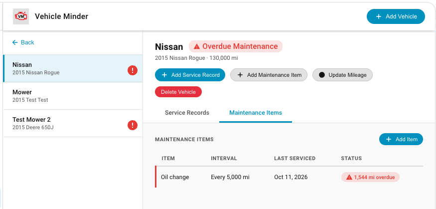
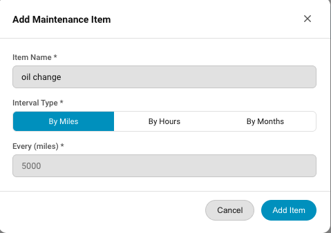
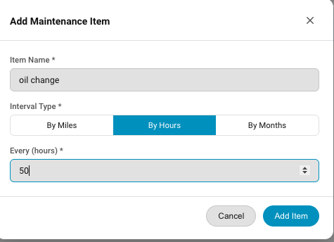
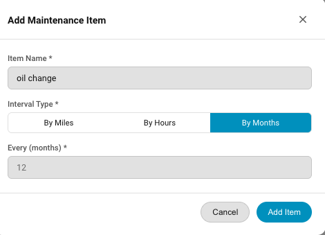

# Maintenance Items

### Overview

Maintenance items are the list of items on each vehicle that need to be maintained.  These are things like oil changes, coolant changes, brake pads or other service items.  Maintenance Items are listed under the "Maintenance Items" tab of a Vehicle Detail View.  

### Adding a Maintenance Item

To add a maintenance item click "Add Maintenance Item in the title row of the Vehicle Detail Card or click the Maintenance Item tab in the Vehicle Detail view, then click "Add Item".  When you add a maintenance item, you select the service interval (miles, hours or months) for that maintenance item.   Miles or Hours should match the usage interval for the vehicle that you are adding to.  Use the "Months" metric for time based maintenance. Some items such as air filters might need to be replaced once per year.

Select the correct usage metric, then enter the interval for that metric.  Then click "Add Item"

