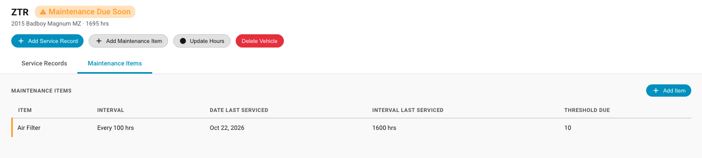
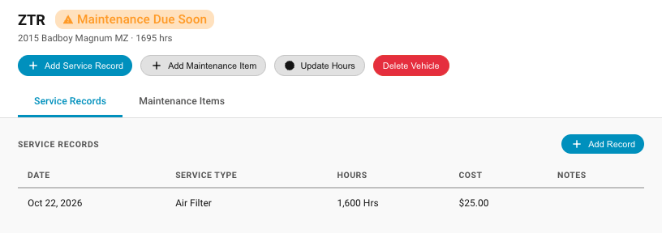
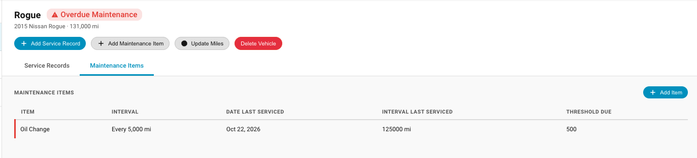
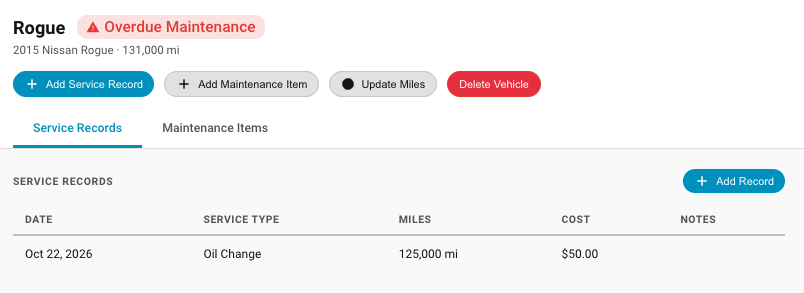

# Maintenance Items

### Overview

Maintenance items are the list of items on each vehicle that need to be maintained.  These are things like oil changes, coolant changes, brake pads or other service items.  Maintenance Items are listed under the "Maintenance Items" tab of a Vehicle Detail View.  

### Adding a Maintenance Item

To add a maintenance item click "Add Maintenance Item in the title row of the Vehicle Detail Card or click the Maintenance Item tab in the Vehicle Detail view, then click "Add Item".  When you add a maintenance item, you select the service interval (miles, hours or months) for that maintenance item.   Miles or Hours should match the usage interval for the vehicle that you are adding to.  Use the "Months" metric for time based maintenance. Some items such as air filters might need to be replaced once per year.

Select the correct usage metric, then enter the interval for that metric.  The interval metric cannot be 0 or empty.  The threshold setting can be left at 0.  If it is left at 0 you will not get Upcoming Maintenance notifications.  You will only be notified of overdue maintenance.  After entering all the data, click "Add Item"

### Upcoming Maintenance
If a maintenance item has the threshold configured when it is created, Vehicle Minder can warn of upcoming maintenance.  In the below we can see current hours on the mower is 1695.  The air filter is scheduled for every 100 hours.  The threshold due is set to 10 hours.  Note in the service record below, the last air filter change was at 1600 hours, so 95 hours ago.  The air filter should be changed every 100 hours, the threshold is 10 hours.  Since it has been 95 hours Vehicle Minder notifies that maintenance on the air filter is coming up.  Once the air filter is changed and a Service Record is created this notificaton will go away.

### Overdue Maintenance
 In the below we can see current hours on the car is 131,000 miles.  The oil change is scheduled for every 5000 miles.  The threshold due is set to 500 miles.  The last oil change was at 125,000 mi.  Since there is no Service Record for oil change within the 5000 miles, Vehicle Minder notifies that maintenance on the oil change is overdue. If the milage difference was within the 500 mile threshold, Vehicle Minder would warn of upcoming maintenance.  After the oil is changed and a Service Record is created, this notificaton will go away.

