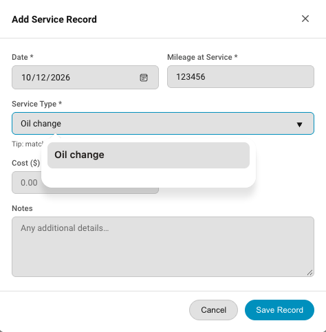

# Service Records

### Overview
Service records are how you track the service history of each of your vehicles.  You can view them by clicking the "Service Records" tab in the vehicle detail view.

### Adding A Service Record
When you add a service record you enter the miles (or hours) on the vehicle at the time of service.  You also have a drop down of maintnenace items to select from so that you know what was serviced.  You cannot add a service record for a maintenance item that does not exist on that vehicle.  This ensures that the overdue maintenance detection is accurate.  You can add a cost for the service, and you can add notes - tools uses, part numbers used, etc.  After entering all the information, click "Save Record". 

 