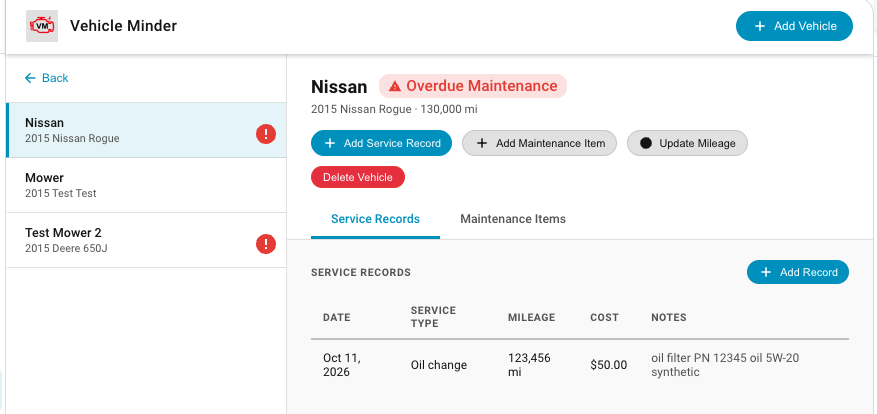
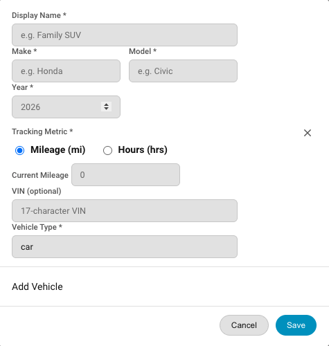
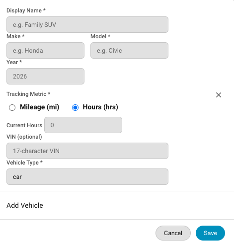
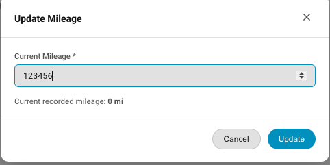

# Working with Vehicles

A vehicle is a member of your fleet.  The detail view shows the vehicle along with tabs for service records and maintenance items.  You can add service records, add maintenance records, delete a vehicle and update usage meter on the vehicle.  Keeping the usage meter updated ensures that that you are alerted if a vehicle is overdue for maintenance.  

### Adding a vehicle
When a vehicle is added to your fleet you can select miles or hours as the usage meter.  Use miles for any onroad vehicle. Use hours for off-road vehicles such as mowers, tractors or heave equipment.  This metric is used to detect any maintenance items that are overdue.  

<table align="center" style="border: none; border-collapse: collapse;">
  <tr>
    <td align="center" style="border: none; padding: 10px;">
      
       Add Vehicle by Miles
    </td>
    <td align="center" style="border: none; padding: 10px;">
      
       Add Vehicle by Hours
    </td>
  </tr>
</table>

### Updating Usage Meter
The usage meter is the mileage driven or the total hours of runtime on the vehicle.  You should periodically update the usage meter.  Do this by clicking the "Update Mileage" or "Update Hours" in the Vehicle detail view. The option you see depends on which usage meter was selected when the vehice was added to your fleet.  Enter the new usage and click "Update" 

### Service History

You can track service history for the vehicles in your fleet.  On the Vehicle Detail page, select the Service Record Tab, then click "Add Record".  See [Service Records](docs/service_records.md) for details on Service Records.

### Adding A Maintenance Item

On the Vehicle Detail page, select the Maintenance Items Tab, then click "Add Item".  See [Maintenance Items](docs/maintenance_items.md) for details on Maintenance Items

### Deleting a Vehicle
On the Vehicle Detail Page click "Delete Vehicle". NOTE: Deleting a vehicle also deletes all maintence items and service record history for that vehicle